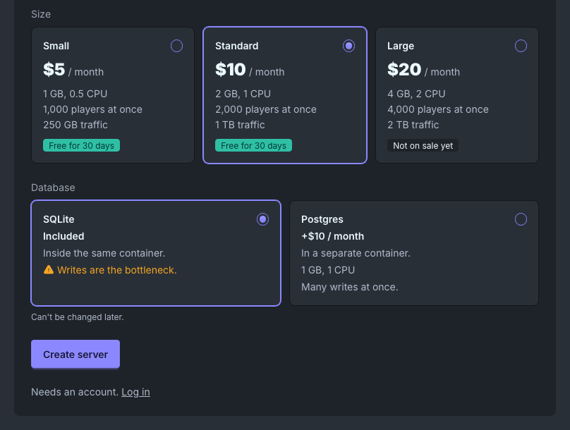
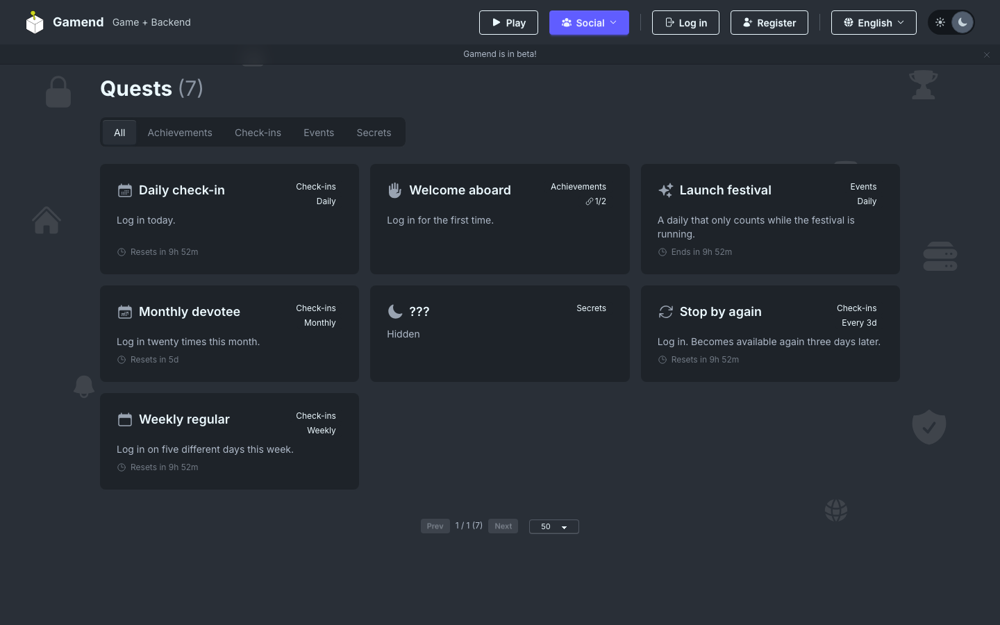
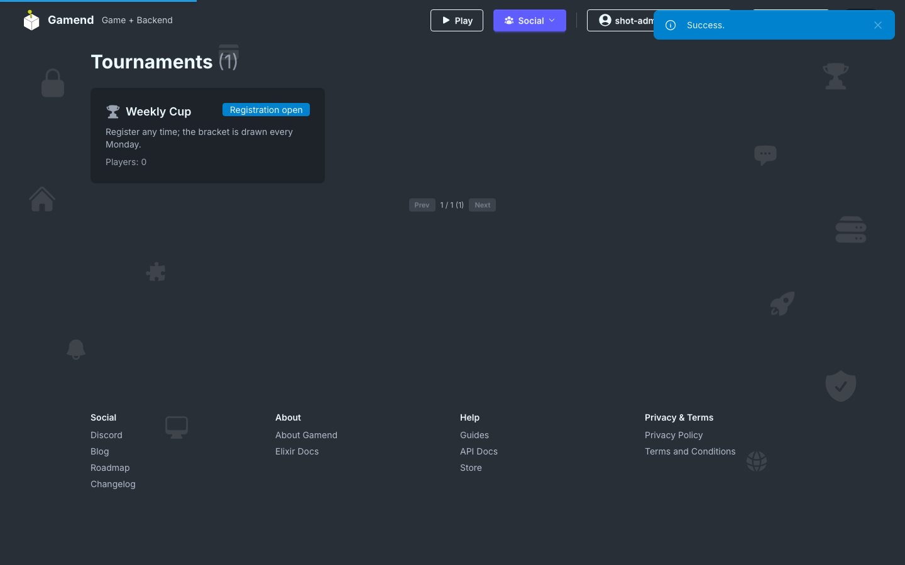
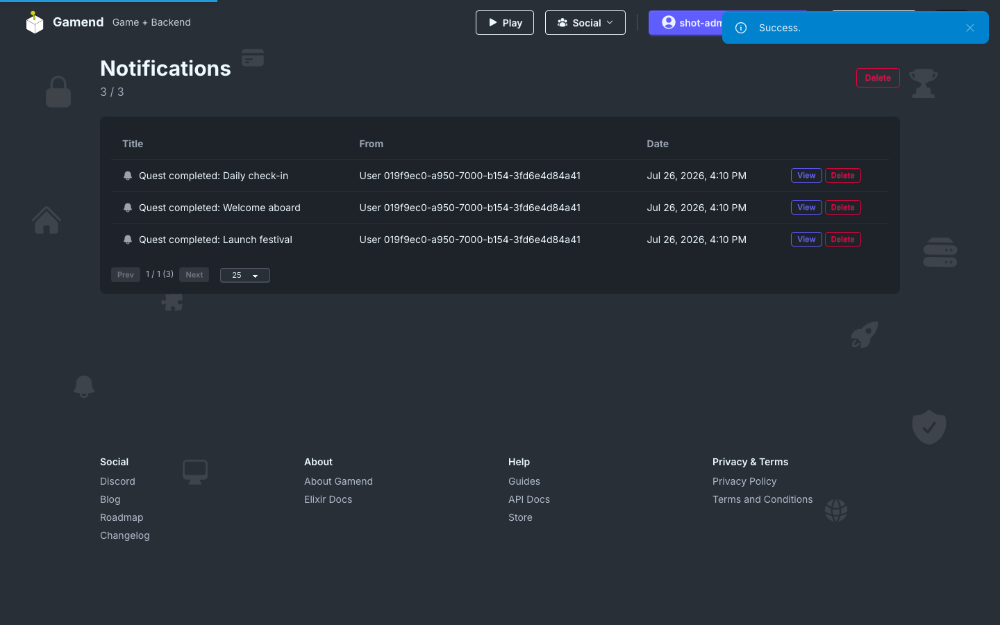
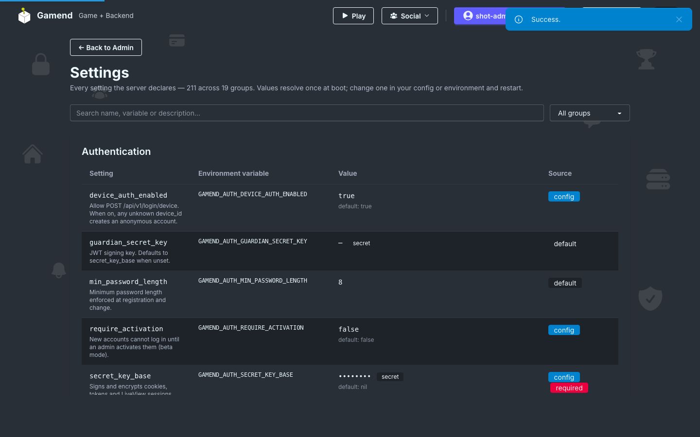

# 2026 Updates

Gamend, our open source Elixir game server, is now at version 1.1. New this year: Gamend Cloud hosting, quests, wallets and payments, matchmaking, tournaments, push notifications and LibGodot.

## Gamend Cloud

[Gamend Cloud](https://gamend.org/blog/gamend-cloud) is hosted Gamend servers, in early access. Pick a name and a size, then deploy the starter, your own GitHub repository or any git URL. Your first server is free for 30 days, and you can export your data and self host at any time.

## Quests

[Quests](https://gamend.org/blog/quests-and-progression) replace the old achievements, with dailies, weeklies, chains, secret quests and time-limited events.

## Economy

[Wallets, a ledger and an inventory](https://gamend.org/blog/economy-and-inventory), with Stripe, Google Play, App Store and Steam payments that grant entitlements server-side.

## Matchmaking and tournaments

[Matchmaking queues, tournaments and ready checks](https://gamend.org/blog/matchmaking-tournaments-ready-checks).

## Notifications

[Push notifications](https://gamend.org/blog/push-notifications) with device token storage, and email digests that batch notices by day, week or month.

## Navigation

[The navbar](https://gamend.org/blog/navigation-sidebar-tab-bar) now comes as a top bar, a sidebar or a phone tab bar, set with one key, with colored icons per section.

## Ops

[One settings library, object storage, Oban jobs and retention](https://gamend.org/blog/settings-storage-jobs). Every setting is declared in code and shows up in admin.

## Godot

[LibGodot integration](https://gamend.org/blog/gamend-libgodot-integration) runs Godot inside the server, so GDScript server logic takes 0.1 to 0.5 ms, close to Elixir.

## Also new

- Guest accounts that keep their progress when they register
- Bans with a reason, for a while or for good
- Groups with slugs, invite links and private types
- Containers and a GitHub App, for hosts that build their customers' code
- Stripe subscription plan changes
- Client calls a host app answers

## Built on Gamend

- [Polyglot Pirates](https://polyglotpirates.com)
- [Forge](https://balaurengine.org)
- [Demo](https://demo.gamend.cloud)
- [Changelog](https://gamend.org/changelog)
- [Github](https://github.com/appsinacup/gamend)
