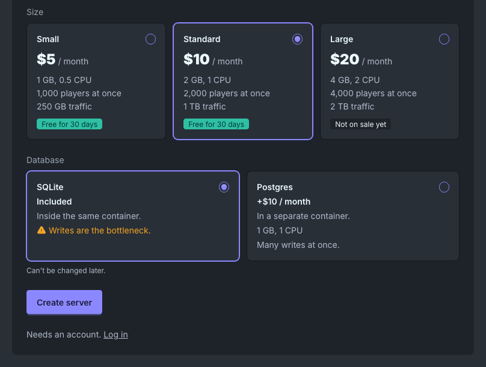
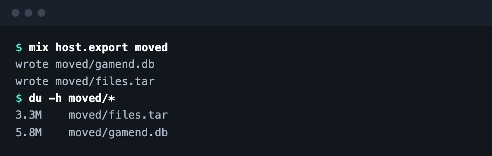

# Containers and Export

Run other servers from yours, and move yours anywhere.

`Gamend.Containers` drives rootless podman: builds, limits, volumes. Gamend Cloud runs on it.

`gamend export` (or `mix host.export`) copies the database and files, even while the server runs.

[Moving hosts](https://gamend.org/docs/deployment) · [Github](https://github.com/appsinacup/gamend)
