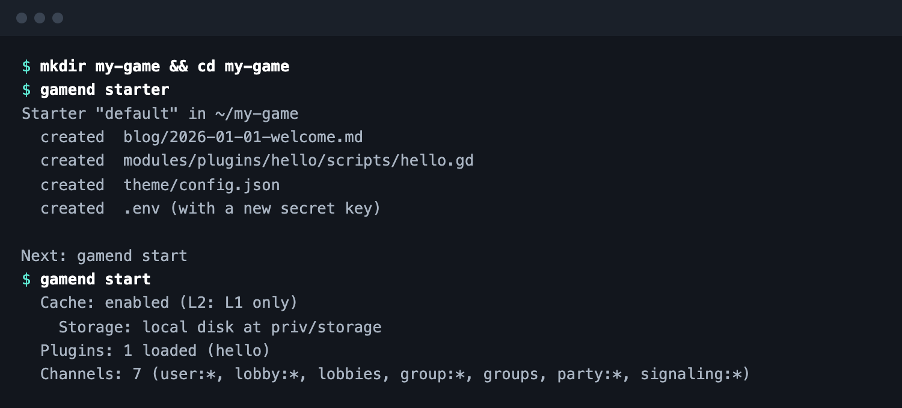
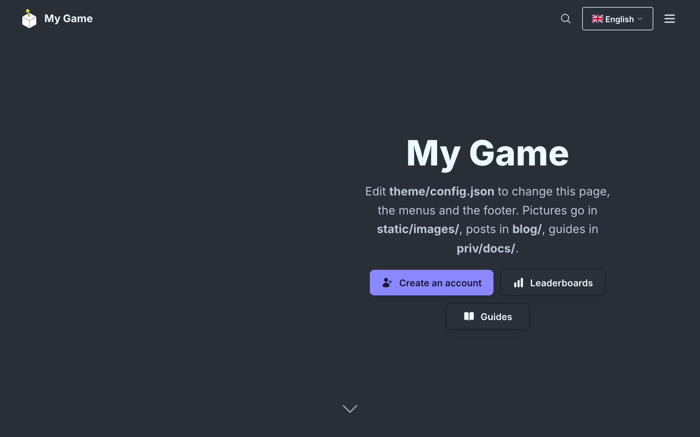

# Download and Run

Gamend is one folder. No Elixir, no Docker.

```bash
curl -fsSL https://raw.githubusercontent.com/appsinacup/gamend/main/rel/install.sh | sh
```





macOS and Linux, SQLite or Postgres. Your theme, pages and plugins live in the project folder.

[Download guide](https://gamend.org/docs/standalone) · [Github](https://github.com/appsinacup/gamend)
