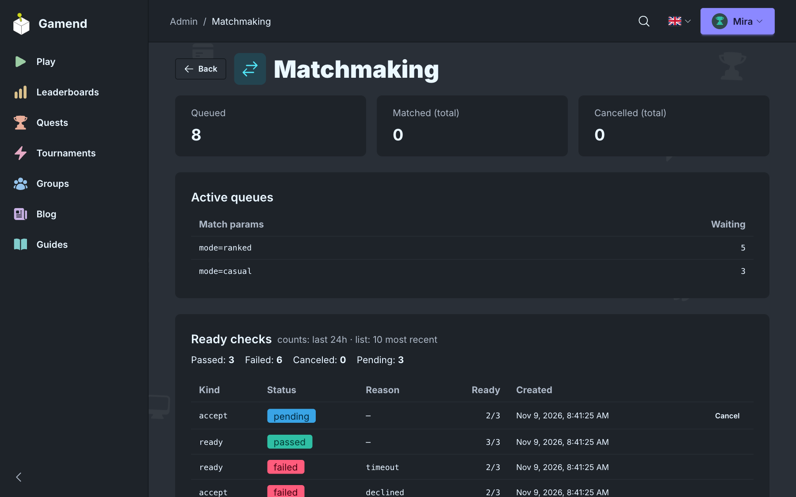

# Matchmaking Rework

Your game decides where a match sits and who accepts first.



- **Seating**: new lobby, running match, or back in the queue. One hook.
- **Backfill**: a host's lobby fills from the queue.
- **Accept**: everyone confirms before anyone is seated.
- **Ratings**: Elo and Glicko-2, for duels, teams and free-for-alls.

```elixir
def matchmaking_seat_match(tickets) do
  case MyGame.room_for(tickets) do
    nil -> MatchSeating.new_lobby(max_users: 10, accept_timeout_ms: 15_000)
    lobby_id -> MatchSeating.in_lobby(lobby_id)
  end
end
```

[Matchmaking](https://gamend.org/docs/matchmaking) · [Ratings](https://gamend.org/docs/ratings) · [Github](https://github.com/appsinacup/gamend)
