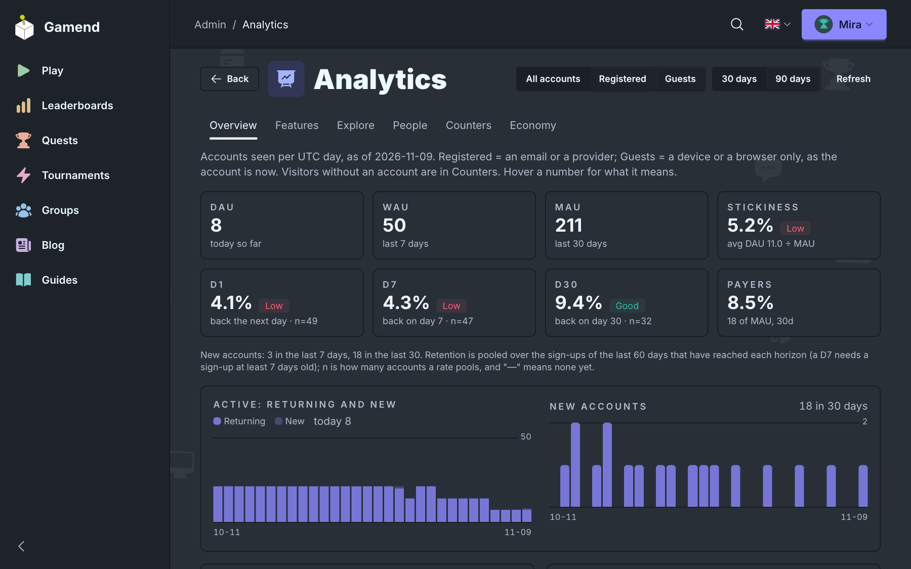
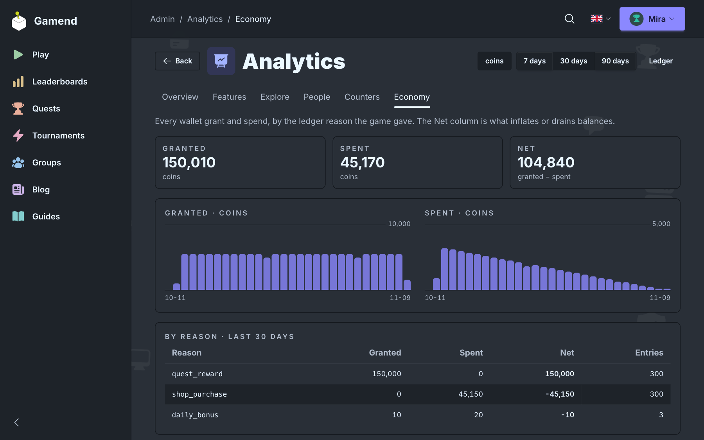

# Player Analytics

Track any event, then read it in admin: retention, features, people and economy.





```elixir
Analytics.track("game.finished", %{mode: :daily, score: 7}, user_id: user_id)
```

[Analytics](https://gamend.org/docs/player-analytics) · [Github](https://github.com/appsinacup/gamend)
