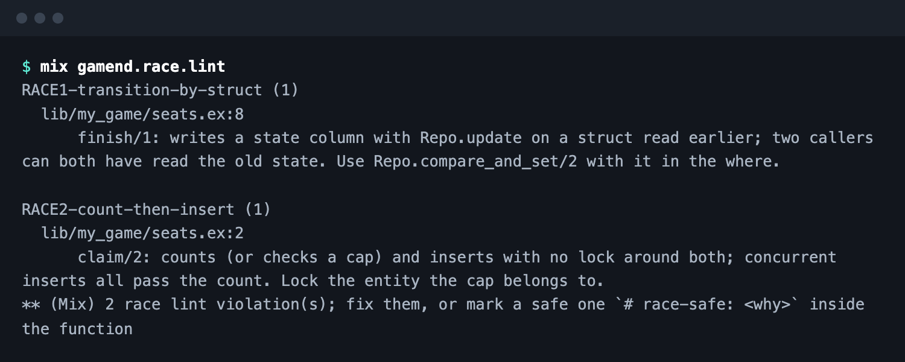

# Race Proofing

Rules now hold when requests land together, and a lint finds the code that would not.



- **One seat, one party, one payout**, even on a double tap.
- **Checked at the write**, not at a read before it.
- **Tested with real racers** on Postgres.

```elixir
from(m in Match, where: m.id == ^id and m.status == "running")
|> Repo.compare_and_set(set: [status: "finished"])
```

[Changelog](https://gamend.org/changelog) · [Github](https://github.com/appsinacup/gamend)
